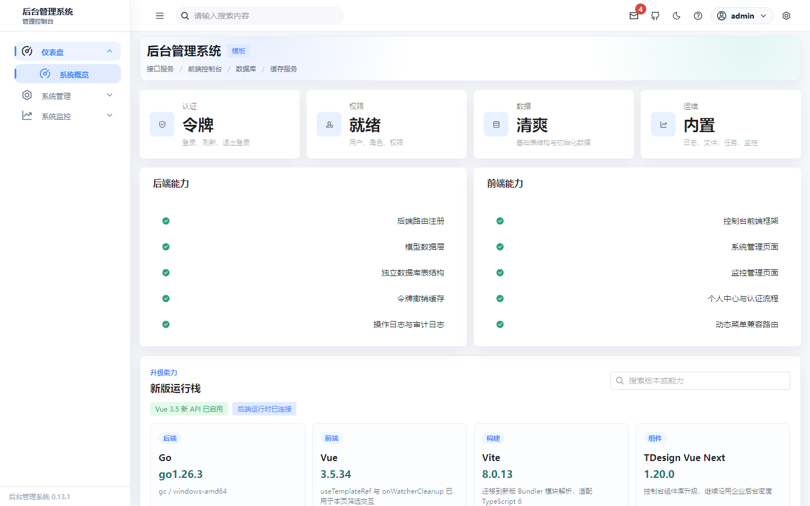

# GopherForge · Go Microservices & Business Platform

[中文](README.md) · [Documentation](https://superiorchuo.github.io/gopherforge/docs/en/) · [Demo](https://superiorchuo.github.io/gopherforge/) · [Changelog](CHANGELOG.md)

[](https://github.com/SuperiorChuo/gopherforge/releases/latest)
[](https://github.com/SuperiorChuo/gopherforge/actions/workflows/ci.yml)
[](LICENSE)

GopherForge (formerly `go-admin-kit`) combines Go + Gin services with a React 19 + Ant Design 6 admin application. It includes authentication, RBAC, multi-tenancy, audit, monitoring and approvals, together with AI, CRM, messaging, payments, official-account integration, notifications, tickets and call-center modules.

**The v0.8.0 scope is the complete product, not an infrastructure-only scaffold.** This branch contains candidate content; Releases is the authority for published versions. Included code does not imply configured third-party integrations or completed production acceptance. This is a 0.x project: back up and rehearse before upgrading.

## Included products

- `microservices/services/`: 16 API services — auth, identity, system, audit, file, monitor, bpm, ai, crm, im, pay, mp, notify, ticket, cc and visibility — with the AI worker embedded in the ai-service process, plus shared libraries.
- `microservices/web/`: complete React admin application, RBAC menus, dark/light themes and a mock-data demo.
- [`clients/hermes-manager/`](clients/hermes-manager/README.md): Hermes management client.
- [`freeswitch-cc/`](freeswitch-cc/README.md): separately deployed FreeSWITCH media stack and control API.
- `platform/`: Prometheus/Grafana and observability configuration.

AI providers, payment gateways, official accounts, SMS and telephone trunks require your own configuration. The main application Compose stack does not automatically start the media stack or desktop client. See [product boundaries](docs/PRODUCT_LINES.md).

## Start locally

Use Linux Docker Engine and Compose v2. Source builds require Go 1.27+ and Node.js 22.12+ (24 recommended).

```bash
git clone https://github.com/SuperiorChuo/gopherforge.git
cd gopherforge
cp microservices/.env.example microservices/.env
# Review passwords, secrets, ports and required business integrations first.
make compose-up
```

Open `http://localhost:8000`. Initial credentials: `admin` / `admin123`; change the password immediately. Stateful infrastructure is separate from the application stack. Do not remove data volumes when stopping the application.

[Local development](LOCAL_SETUP.md) · [Deployment](docs/deployment.md) · [Upgrade guide](https://superiorchuo.github.io/gopherforge/docs/en/reference/upgrade) · [Security](docs/SECURITY.md)

The online demo uses mock data, not live business APIs, and is not a backend acceptance environment. The deployed Pages version may differ from this candidate branch.

## Upgrade safely

Published SQL migrations retain their original paths and bytes. Complete-product upgrades append forward-only migrations. Never overwrite historical migrations or run production `goose down/reset`. Back up and rehearse on an isolated copy; recover using a verified backup rather than an irreversible Down operation.

[Migration policy](docs/development/MIGRATIONS.md) · [Release validation](docs/release-validation.md)

## Validate

```bash
npm ci --prefix microservices/web
bash scripts/verify-product.sh all
bash scripts/verify-product.sh public-migrations
npm ci --prefix website
npm test --prefix website
```

Local gates do not replace live service/API/worker/UI/monitoring or external-provider acceptance. See the release validation guide for isolated database, browser and release-identity requirements.

[Contributing](CONTRIBUTING.md) · [API contracts](docs/development/API_CONTRACT.md) · [Agent kernel](docs/agent-kernel.md) · [MIT License](LICENSE)


