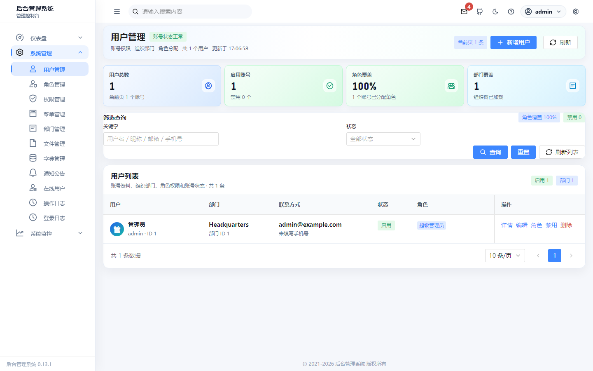

# GopherForge · Go 微服务管理与业务平台

[English](README.en.md) · [文档站](https://superiorchuo.github.io/gopherforge/docs/) · [在线 Demo](https://superiorchuo.github.io/gopherforge/) · [版本记录](CHANGELOG.md)

[](https://github.com/SuperiorChuo/gopherforge/releases/latest)
[](https://github.com/SuperiorChuo/gopherforge/actions/workflows/ci.yml)
[](LICENSE)

**GopherForge**（曾用名 `go-admin-kit`）以 Go + Gin 微服务和 React 19 + Ant Design 6 管理台为基础，提供认证、RBAC、多租户、审计、监控、审批，以及 AI、CRM、即时通信、支付、公众号、通知、工单和呼叫中心业务模块。

**v0.8.0 的发行范围是完整产品，不再仅限基础脚手架。** 本分支是候选内容，正式发布状态以 Releases 为准；代码存在不代表第三方服务已开通或生产验收已完成。项目仍处于 0.x 阶段，升级前须备份并演练迁移。

## 产品范围

| 目录 | 内容 |
|---|---|
| `microservices/services/` | 16 个 API 服务：auth、identity、system、audit、file、monitor、bpm、ai、crm、im、pay、mp、notify、ticket、cc、visibility；AI worker 内嵌于 ai-service 进程，另含共享库 |
| `microservices/web/` | 完整 React 管理台；RBAC 菜单、暗/亮主题及纯前端 Demo |
| `clients/hermes-manager/` | Hermes 管理客户端，见[客户端说明](clients/hermes-manager/README.md) |
| `freeswitch-cc/` | 独立部署的 FreeSWITCH 媒体与 control-api，见[媒体说明](freeswitch-cc/README.md) |
| `platform/` | Prometheus、Grafana 等可观测配置 |

各业务的运行依赖与边界见[产品说明](docs/PRODUCT_LINES.md)。AI 供应商、公众号、短信及电话中继需自行配置。Pay 当前仅提供用于隔离测试/演示的 mock 渠道，微信/支付宝适配器尚未实现，不能仅配置商户凭据用于真实收款。媒体栈和客户端不由主应用 Compose 自动启动。

## 快速启动

需要 Linux Docker Engine/Compose v2；本地编译需要 Go 1.27+、Node.js 22.12+（推荐 24）。

```bash
git clone https://github.com/SuperiorChuo/gopherforge.git
cd gopherforge
cp microservices/.env.example microservices/.env
# 先检查并修改密码、密钥、端口及所需业务配置
make compose-up
```

访问 `http://localhost:8000`。首次登录 `admin` / `admin123`，登录后立即修改密码。数据栈与应用栈分离，停止应用不要删除数据卷。完整启动取决于机器资源和镜像下载，不承诺固定分钟数。

- [本地联调](LOCAL_SETUP.md)
- [生产部署](docs/deployment.md)
- [版本升级](https://superiorchuo.github.io/gopherforge/docs/reference/upgrade)
- [安全说明](docs/SECURITY.md)

在线 Demo 使用假数据，不连接真实业务 API，不是完整后端验收环境；GitHub Pages 显示的是已经部署的版本，未必与候选分支一致。

## 升级与数据库

公开历史 SQL 保持原路径、原字节；完整产品升级使用追加的 forward-only 迁移。不要用源码目录覆盖旧迁移，也不要在生产运行 `goose down/reset`。请先备份数据库并在隔离副本演练；恢复使用经过验证的备份，不依赖不可逆迁移的 Down。

迁移说明：[MIGRATIONS](docs/development/MIGRATIONS.md) · [发行验证](docs/release-validation.md)。

## 验证与开发

```bash
npm ci --prefix microservices/web
bash scripts/verify-product.sh all
bash scripts/verify-product.sh public-migrations
npm ci --prefix website
npm test --prefix website
```

这些本机门禁不等于服务/API/worker/UI/live 监控及外部供应商的运行验收。隔离数据库、浏览器与发布身份验证要求见[发行验证](docs/release-validation.md)。

[参与贡献](CONTRIBUTING.md) · [API 契约](docs/development/API_CONTRACT.md) · [AI Agent 内核](docs/agent-kernel.md)

## 界面预览

| 管理台 | 用户管理 |
|---|---|
|  |  |

截图展示已有管理页面，不作为所有业务链路的验收证据。

## 交流与许可证


[MIT License](LICENSE)
